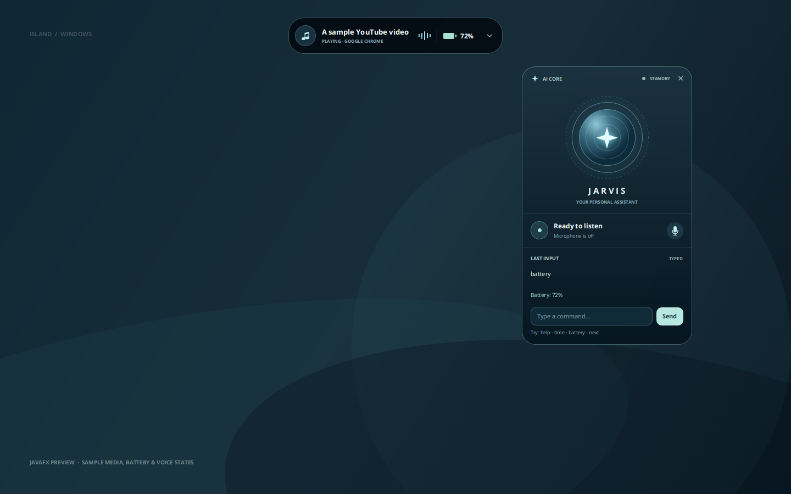
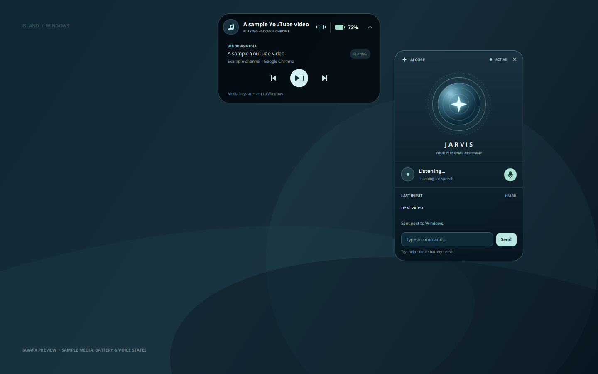

# Island for Windows — JavaFX & FXML

A Windows desktop companion with a top-centered Dynamic Island and a separate JARVIS core. The **primary implementation is JavaFX**: its layouts are written in **FXML**, its behavior is Java, and its styling is JavaFX CSS. It is not a website and does not require Node.js or Electron to run.

> **Status:** The JavaFX views, typed/voice command handling, and simulated media updates have been tested headlessly on Linux. The new Windows media-session and speech integration still need testing on Windows. The earlier Windows preview build is unsigned and does not include these latest changes.

## What it looks like

| Compact island | Expanded media controls |
| --- | --- |
|  |  |

These images are rendered from the actual FXML views on a simulated desktop. The video title, 72% battery, command, and listening state are **sample preview data**, not readings from a real device or microphone.

## Features

- A transparent, always-on-top island centered in the primary display's work area.
- Windows battery percentage via `GetSystemPowerStatus`; `--` means no reading is available.
- The title, artist/channel, and playback state reported by the current Windows media session. This can include YouTube videos when the browser exposes them to Windows.
- Expandable previous, play/pause, and next buttons that send Windows media keys.
- A separate draggable JARVIS card with a command input, the last recognized or typed phrase, and a visible response.
- An opt-in microphone, system-tray menu, optional `Ctrl+Alt+J` hotkey, and single-instance guard.
- JavaFX and FXML UI, with Java Native Access (JNA) used for small Windows API calls.

## Requirements

- 64-bit Windows 10 (version 1809 or newer) or Windows 11, with Windows PowerShell 5.1 and .NET Framework support for Windows Runtime.
- A player or browser that exposes a Windows media session for track/video information and responds to Windows media keys for controls.
- For voice: a microphone, Windows desktop-app microphone permission, and a compatible installed Windows speech recognizer. The supported command phrases are in English; typing works without a microphone.
- To **build from source**: JDK 17 or newer and network access to Maven Central. Use IntelliJ IDEA's bundled Maven or install Maven 3.8 or newer for command-line builds. A packaged app image includes its own Java runtime.

## Open in IntelliJ IDEA

1. Choose **File → Open** and select the repository root (the folder containing `pom.xml`). Trust the project if prompted and allow IDEA to import the Maven project and download its dependencies.
2. In **File → Project Structure**, select a JDK 17 or newer as the project SDK. If necessary, select the same JDK for the Maven runner in IDEA's Maven settings.
3. In the run-configuration dropdown at the top right, select the shared **Island JavaFX** Maven configuration and click **Run**. Do not use an automatically generated **Launcher** application configuration: it can put JavaFX on the classpath and cause an `unnamed module` warning. Select **Island Tests** to run the JUnit tests.
4. If the shared configuration is missing, reload the Maven project and select it again, or open the **Maven** tool window and run the `javafx:run` goal. The shared configurations are stored in `.run/`; the JavaFX Maven plugin supplies the module path without machine-specific VM options.
5. The JavaFX views are `src/main/resources/com/islandfx/island.fxml` and `jarvis.fxml`; the Java controllers are in `src/main/java/com/islandfx/`.

The project is designed for IDEA's Maven import; the IDE setup and Windows-specific features have not yet been tested on Windows.

## Run or build on Windows

The earlier cross-built JavaFX preview ZIP does **not** include the latest command input or media-session features. It has not been tested on Windows and is unsigned; its JavaFX SDK files came from community mirrors and have not been independently verified. See [preview provenance](docs/javafx-preview-provenance.md). To try the current version, run or build it from source on Windows.

To run directly from source, open PowerShell in the repository root:

```powershell
mvn clean verify
mvn javafx:run
```

To create a portable Windows app image with `Island.exe` and its own Java runtime, use a full JDK with `jpackage`:

```powershell
.\build-windows.ps1 -Package
```

The result is `target\package\Island\Island.exe`. Keep the whole `Island` folder together when moving it. This packaging script has not yet been run on Windows. `mvn clean verify` runs the JUnit logic tests; the JavaFX UI smoke harnesses in `src/test/` were also run headlessly in the development environment.

**Important:** `old/downloads/Island-Windows-x64.zip` is the earlier C++/Win32 build, not this JavaFX implementation. It is retained only as a legacy reference; do not use it to evaluate the JavaFX version.

## Controls

| Action | Control |
| --- | --- |
| Expand or collapse media controls | Click the top island |
| Previous, play/pause, next | Click the corresponding control in the expanded island |
| Type a command | Type in JARVIS and press **Enter** or **Send**; the microphone stays off |
| See what was heard | Look at **LAST INPUT**: tentative words are marked **HEARING**, recognized speech **HEARD**, and rejected speech **NOT RECOGNIZED**. Only recognized speech is executed. |
| Start or stop listening | Click the JARVIS orb or mic button, use the tray menu, or press `Ctrl+Alt+J` if available |
| Move JARVIS | Drag its header |
| Hide JARVIS | Click its **×** or the tray icon. Hiding it stops listening. |
| Show JARVIS | Use the tray icon or right-click the island |
| Exit | Right-click the island or tray icon and select **Exit Island** |

## Voice commands and privacy

The microphone is **off by default**. You can type a command without enabling it. On request, the Java app starts a local Windows PowerShell worker using `System.Speech`; the worker exits when listening stops, JARVIS is hidden, or the app exits. If the installed recognizer supplies tentative results, they appear while you speak; the finalized phrase appears when processed. The app does not itself send audio to a cloud service or save a transcript.

A separate local PowerShell worker reads the Windows media session, including any title, artist/channel, source, and playback state the player shares with Windows. It does not read browser history or capture audio. The worker runs while Island is open and stops on exit.

| Example phrase | Action |
| --- | --- |
| `play music`, `pause music`, or `play video` | Send the play/pause media key |
| `next track`, `next video`, or `previous track` | Send the corresponding media key |
| `what time is it` | Show local time |
| `battery` | Show the Windows battery reading |
| `help` | Show command examples |
| `stop listening` | Stop microphone input |

JARVIS is a **small local command interface, not general-purpose AI**. The island displays playback metadata only when Windows reports it; unavailable or missing information is not invented. Media keys are sent to Windows and can affect a different session if several players are open. Both “play” and “pause” send the same Windows play/pause **toggle**; a successful key send does not guarantee that a player acted on it.

## Troubleshooting

- **“Unsupported JavaFX configuration: classes were loaded from 'unnamed module'”:** This warning means JavaFX was launched on the classpath, typically by IntelliJ's auto-generated `Launcher` configuration. It is not itself a crash. Select the shared **Island JavaFX** Maven run configuration (or run `mvn javafx:run`) so JavaFX is placed on the module path. If the app still does not appear, check the rest of the console output for an exception or an exit code.
- **Voice is unavailable or nothing is heard:** Check the default microphone, Windows desktop-app microphone permissions, and an installed Windows speech recognizer. Start listening with the mic button and speak an English command. Error details appear in the card; hover over a truncated message to read it. You can also type `help` to check commands without the microphone.
- **A YouTube title doesn't appear:** Play the video in a browser that publishes a Windows media session. Check whether the video appears in Windows' media controls. Some browsers or sites do not expose metadata, and Windows may select a different session when multiple players are active. If the island says **MEDIA UNAVAILABLE**, expand it and hover over the message for any diagnostic detail. Check Windows Runtime support; this integration still needs Windows testing.
- **Battery shows `--`:** Windows could not provide a reading, or the device reports no battery.
- **Media controls do nothing:** Open a player that responds to Windows media keys; Windows chooses which app receives them.
- **Shortcut does nothing:** Another application may have registered `Ctrl+Alt+J`; use the core or tray menu.
- **The app does not launch:** Check the output from `mvn javafx:run`, or use `Run-Island-Debug.cmd` if it is included in your preview ZIP.

## Repository layout

| Path | Purpose |
| --- | --- |
| `pom.xml` | Root Maven project; open this folder directly in IntelliJ IDEA |
| `.run/` | Shared IntelliJ IDEA run and test configurations |
| `src/main/resources/com/islandfx/*.fxml` | Island and JARVIS FXML views |
| `src/main/resources/com/islandfx/island.css` | JavaFX styling |
| `src/main/resources/com/islandfx/media-session.ps1` | Local Windows media-session helper |
| `src/main/java/com/islandfx/` | Controllers, app lifecycle, command logic, and Windows integration |
| `src/test/` | JUnit logic tests and UI/preview harnesses |
| `build-windows.ps1` | Maven build and optional `jpackage` app-image script |
| `launcher/` | Small optional native launcher for a bundled Java runtime; the interface remains JavaFX/FXML |
| `docs/previews/` | JavaFX-rendered preview images with simulated values |
| `docs/suggestions.md` | Suggested UI/UX improvements and future features |
| `old/` | Earlier C++/Win32 and browser/Electron prototypes, including their tests and the old executable |
