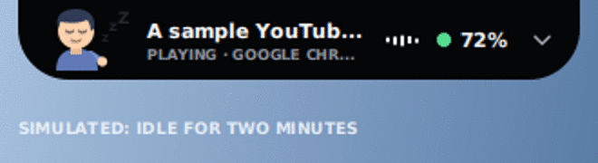
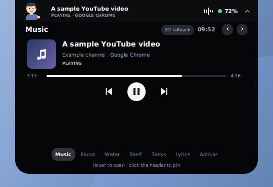
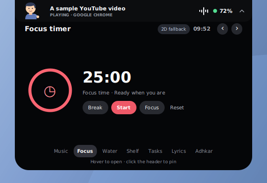
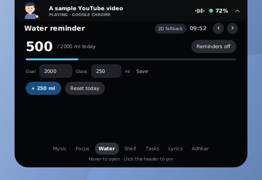
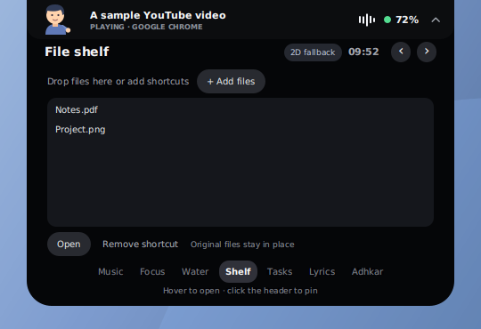
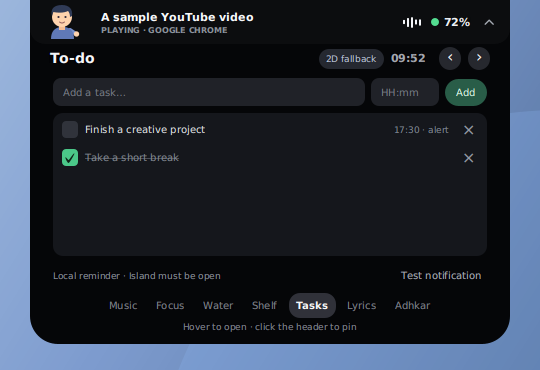
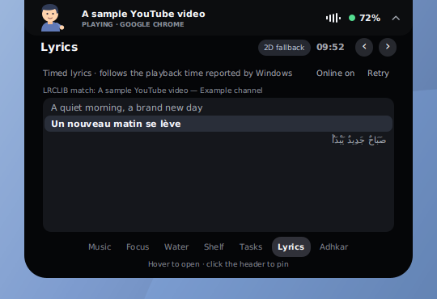
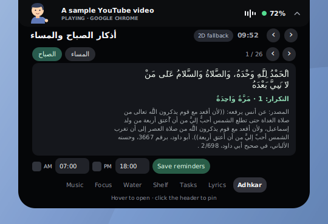

# Island for Windows — JavaFX & FXML

A Windows desktop companion with a top-centered Dynamic Island and a separate, draggable JARVIS core. The application is **JavaFX/FXML**, not a website or an Electron app. This version takes visual inspiration from [Nusa 1.0.0](https://github.com/rama2555/nusa/releases/tag/v1.0.0): a dark notch, hover expansion, spring-like motion, and multiple useful pages. The JavaFX interface and behavior were implemented independently.

> **Status:** The Java logic and FXML views have been exercised headlessly on Linux with simulated media and reminders. Windows packaging, media, microphone, native notifications, online LRCLIB access and hardware-accelerated 3D **still need a real Windows test**. No current signed installer is provided.

## Preview

| Opening and pages | Sleeping and waving |
| --- | --- |
|  |  |

These animations capture the JavaFX views with simulated data and idle events; they are not Windows recordings. The companion preview is zoomed in. The headless renderer cannot display JavaFX 3D, so **all previews show the 2D fallback**, not either of the selectable 3D models.

| Compact island and JARVIS | Expanded island and JARVIS |
| --- | --- |
|  |  |

| Music | Focus | Water |
| --- | --- | --- |
|  |  |  |

| File shelf | To-do |
| --- | --- |
|  |  |

| Lyrics | أذكار الصباح والمساء |
| --- | --- |
|  |  |

The controls are rendered from the real FXML on a **simulated desktop**, with sample media, 72% battery, invented lyric lines, tasks and voice state. The adhkar page uses the bundled Arabic data. The section images are crops of those renders, not screenshots from Windows; fonts and system behavior may differ. See [preview notes](docs/javafx-preview-provenance.md).

## What it does

- **Music:** Shows the title, artist/channel, playback state and, when provided, elapsed time and duration from the current Windows media session. Previous, play/pause and next send Windows media keys. The progress bar is read-only; artwork is a placeholder.
- **Focus:** A 25-minute focus timer and 5-minute break timer, with start, pause and reset. A completion reminder appears while the app is running.
- **Water:** Track glasses toward a configurable daily goal, reset today's total, and optionally receive hourly reminders until the goal is reached.
- **Shelf:** Drag files onto the island or choose files to save shortcuts. Open a selected file, drag it out, or remove its shortcut without deleting the original.
- **Lyrics:** Automatically search LRCLIB for the current track in its original language, including English, French and Arabic when available. Timed lyrics follow Windows' reported position; plain lyrics are labeled separately. Online lookup can be switched off.
- **أذكار الصباح والمساء:** Browse an offline Arabic morning/evening collection, with its supplied repetition counts and sources, and set optional daily reminders.
- **To-do:** Add, complete and remove tasks. An optional local `HH:mm` time schedules a one-time system notification; use **Test notification** to check the route.
- **Idle companion:** Choose a stylized 3D bust or an anatomical 3D head/bust. The character blinks, waves on startup and return, and sleeps with floating Zs after two minutes of Windows inactivity. A 2D animated fallback is used when JavaFX 3D is unavailable. Music and battery information remain visible.
- **Battery and JARVIS:** Show the Windows battery reading, or `--` if unavailable. JARVIS has typed commands, opt-in speech, a transcript/status display, and a visible response.
- **Desktop controls:** Always-on-top windows, a system-tray menu where available, an optional `Ctrl+Alt+J` voice shortcut, and a single-instance guard.

A browser can show YouTube metadata **only if it exposes that information to Windows**. The displayed source may be the browser rather than the site. Media keys go to Windows and can affect a different player when multiple sessions exist.

## Requirements

- 64-bit Windows 10 version 1809 or later, or Windows 11; Windows PowerShell 5.1 and .NET Framework Windows Runtime support are used for media and speech.
- A player or browser that publishes a Windows media session and responds to Windows media keys.
- For lyrics: an internet connection to `lrclib.net`; results depend on the metadata and the provider's catalog. Lyrics are not translated.
- For the 3D companion: a JavaFX 3D-capable graphics pipeline and working graphics drivers. Otherwise the app uses its 2D fallback.
- For voice: a microphone, Windows desktop-app microphone permission and a compatible installed Windows speech recognizer. Commands are English; typing works without a microphone.
- To build: a **JDK 17 or newer**, Maven 3.8+ (or IntelliJ IDEA's bundled Maven) and network access to Maven Central. Packaging requires a full JDK with `jpackage`.

## Open in IntelliJ IDEA

1. Choose **File → Open** and select the repository root containing `pom.xml`. Trust the project if prompted and allow Maven dependencies to download.
2. In **File → Project Structure**, select a JDK 17 or newer as the project SDK. If necessary, select the same JDK for IDEA's Maven runner.
3. Select the shared **Island JavaFX** Maven configuration in the run dropdown and click **Run**. Select **Island Tests** to run the JUnit tests.
4. If the shared configuration is missing, reload the Maven project, or run the `javafx:run` goal from the Maven tool window. Do not use an automatically generated **Launcher** application configuration: it can put JavaFX on the classpath and produce an `unnamed module` warning.
5. The layouts are `src/main/resources/com/islandfx/island.fxml` and `jarvis.fxml`; Java controllers are in `src/main/java/com/islandfx/`.

The shared configurations are in `.run/`. The JavaFX Maven plugin supplies the module path without machine-specific VM options. IDEA setup has not yet been verified on Windows.

## Run or build on Windows

In PowerShell at the repository root:

```powershell
mvn clean verify
mvn javafx:run
```

To build a portable app image containing `Island.exe` and a Java runtime:

```powershell
.\build-windows.ps1 -Package
```

The intended output is `target\package\Island\Island.exe`; keep the whole `Island` folder together. The packaging script has **not yet been run on Windows**. The `old/downloads/Island-Windows-x64.zip` file is a legacy C++/Win32 build, not this JavaFX app and not the current feature set.

## Controls

| Action | Control |
| --- | --- |
| Open temporarily | Hover over the top-centered island; it closes shortly after the pointer leaves. |
| Pin or close | Click the island header; interacting with a page also pins it. Click the pinned header again or press **Esc** to close. |
| Change page | Select **Music**, **Focus**, **Water**, **Shelf**, **Tasks**, **Lyrics** or **Adhkar**, use the arrow buttons, or use left/right arrow keys outside a text field. |
| Focus | Choose **Focus** or **Break**, then **Start**, **Pause**, or **Reset**. Selecting a mode resets that timer. |
| Water | Set goal and glass size in milliliters and press **Save**; use **+ ml**, **Reset today**, and the reminders toggle. |
| Shelf | Drop files on the island or press **+ Add files**. Select a shortcut to open or remove it; double-click to open, or drag a listed file out. |
| To-do | Enter a task and an optional local `HH:mm` reminder, then press **Add**. Use the checkbox or **×** to complete or remove it. **Test notification** sends a test through the same reminder route. |
| Lyrics | Play a track exposed to Windows and select **Lyrics**. Use **Retry** after an error or **Online on/off** to control automatic network lookup. |
| Adhkar | Select **Adhkar**, choose **الصباح** or **المساء**, and use the arrows and scroll area to read each text, count and source. Set the AM/PM checkboxes and local 24-hour times, then press **Save reminders**. |
| Companion style | In the expanded header, click **3D: soft** / **3D: real** to switch styles. **2D fallback** indicates JavaFX 3D is unavailable; the selection is still saved for a 3D-capable system. |
| Type a command | Type in JARVIS and press **Enter** or **Send**. This does not enable the microphone. |
| Start or stop listening | Click the JARVIS orb or microphone button, use the tray menu, or press `Ctrl+Alt+J` if available. |
| Move, hide or show JARVIS | Drag its header; click **×** or the tray icon to hide. Use the tray icon or right-click the island to show it. Hiding stops listening. |
| Exit | Right-click the island or tray icon and select **Exit Island**. |

The last input in JARVIS is marked **HEARING** for tentative words, **HEARD** for recognized speech, **NOT RECOGNIZED** for rejected speech, or **TYPED** for typed commands. Only recognized speech is executed. “Listening...” is shown when the microphone is active.

The character checks the elapsed time since the last Windows input about once per second. After two minutes it dozes, even if music is playing; keyboard or mouse activity wakes it with a short wave. If Windows cannot report idle time, the character stays awake. It does not capture or store keystrokes, mouse positions or input history. The anatomical option uses an untextured MakeHuman-derived head with simple hair, eyes, clothing and arm geometry; it is not photorealistic. 3D rendering and the Windows idle API still need testing on a real Windows machine.

## Local data and reminders

Water settings, today's water total, shelf paths, tasks, adhkar reminder settings, online-lyrics preference and companion style are saved locally in `%LOCALAPPDATA%\IslandFX\companion.properties` on Windows; if `LOCALAPPDATA` is unavailable, the fallback is `~/.islandfx/companion.properties`. This file is not encrypted and can contain task text and file paths. Existing task files remain compatible. The shelf stores paths, **not copies**; moving or deleting an original file can make its shortcut unavailable. The shelf and task list each accept up to 200 entries.

The water total resets on the next local calendar day. The goal must be 250–10,000 ml and the glass size 50–2,000 ml. Water reminders are off by default; when enabled, they occur at most hourly while the app is open and the goal has not been met. Drinking, resetting, enabling the reminder or restarting the app starts a new hourly interval.

Task times use the local clock. A time that has already passed means the next day; a due, unfinished task that was not notified while the app was closed is checked when it next starts. **Alert** means a reminder is scheduled; **alerted** means delivery was requested, not that Windows displayed it.

Morning and evening adhkar reminders are independently configurable and **off by default**. Their initial times are `07:00` and `18:00`; enter 24-hour local times and press **Save reminders**. They recur while Island is running. A time missed while the app was closed is skipped rather than delivered at startup. If the app remains open but the computer sleeps across a due time, it requests one reminder on the next tick.

On Windows the app first attempts a native toast through Windows PowerShell's registered app identity, so the notification may be labeled **Windows PowerShell**. If the toast helper reports a failure, it tries the system tray; if the tray is unavailable, it opens the island with the message. Windows notification settings, Focus Assist, app identity registration, and system policy can suppress messages, and Action Center history is **not guaranteed**. Use **Test notification** and check Windows notification settings before relying on reminders. This Windows route has not been tested on Windows.

The focus timer is **not persisted** and does not run when the app is closed. There is no background service, OS task scheduler or cloud sync.

If the data file cannot be read, the island shows a warning and avoids overwriting it; new changes are temporary. If saving fails, a warning is shown. Back up the file before attempting manual recovery.

## Voice commands and privacy

The microphone is **off by default**. On request, a local PowerShell worker uses `System.Speech` and exits when listening stops, JARVIS is hidden, or the app exits. The app does not itself upload audio or save a transcript. Recognition depends on the installed Windows recognizer.

A separate local PowerShell worker reads metadata that players share with the Windows media-session API. It does not read browser history or capture audio, and it stops when the app exits.

**Online lyrics are on by default.** When a track title is available, Island sends its title and artist to [LRCLIB](https://lrclib.net/) over HTTPS, including a best-effort title/artist inferred from common video titles when applicable. It does not send audio, browser history, file paths or tasks. Use **Lyrics → Online off** to stop lookups; this preference is saved locally, and an in-flight lookup is canceled/ignored. Lyrics are held in memory only, not saved to the companion data file. LRCLIB's own policies apply to information it receives.

Matching is best-effort; inspect the displayed provider match. Some tracks, languages, live streams or browser sessions have no usable lyrics or timeline. Timestamped lyrics highlight the line based on the playback position Windows reports; if no position is reported they are shown without highlighting. Plain lyrics are labeled **Plain lyrics**. No translation or word-by-word synchronization is provided.

| Example phrase | Action |
| --- | --- |
| `play music`, `pause music`, `play video` | Send the Windows play/pause key |
| `next track`, `next video`, `previous track` | Send the corresponding media key |
| `what time is it` | Show local time |
| `battery` | Show the battery reading |
| `help` | Show command examples |
| `stop listening` | Stop microphone input |

JARVIS is a **limited local command interface, not general-purpose AI**. Both “play” and “pause” send the same media-key toggle; a successful key send does not guarantee the player acted on it. Missing media data is shown as unavailable rather than invented.

## Data and asset credits

- Arabic data: [Seen Arabic's Morning and Evening Adhkar database](https://github.com/Seen-Arabic/Morning-And-Evening-Adhkar-DB), `ar.json` from commit `29d7623fede52eca835a789025dfda866e8cfe44`, distributed under the [MIT license](docs/licenses/adhkar-MIT.txt), copyright 2024 Seen Arabic. The upstream project credits *Hisn al-Muslim* and works by Sheikh Muhammad Ismail al-Muqaddim, among other sources. Counts and source citations are presented as supplied by the dataset; they have not been independently verified here.
- Anatomical 3D head: a cropped head/neck excerpt from [MakeHuman `base.obj`](https://github.com/makehumancommunity/makehuman/blob/a8bc2d54ff0ac92e78ff71431b1023eda42bf482/makehuman/data/3dobjs/base.obj), whose header states **CC0 1.0** and credits Data Collection AB, Joel Palmius and Jonas Hauquier. The [CC0 text](docs/licenses/makehuman-CC0.md) is included. The excerpt was triangulated by [`tools/extract-makehuman-head.py`](tools/extract-makehuman-head.py); the original full-body mesh and helper geometry are not bundled. The project adds simple 3D hair, clothing, eyes and animation.
- Lyrics search: [LRCLIB](https://github.com/tranxuanthang/lrclib); the service supplies lyrics and may change or be unavailable. JSON parsing uses [Gson](https://github.com/google/gson) (Apache-2.0).

The bundled data/asset notices are also included in the application JAR under `META-INF/licenses/`.

## Troubleshooting

- **JavaFX `unnamed module` warning:** Select the shared **Island JavaFX** Maven run configuration, or run `mvn javafx:run`. Check the rest of the console output if the app still does not appear.
- **Voice unavailable or nothing heard:** Check the default microphone, desktop-app microphone permissions and an installed Windows speech recognizer. Start listening and speak a supported English command. Error details appear in the card; hover over truncated text. Type `help` to test without a microphone.
- **YouTube title missing:** Check that the playing video appears in Windows media controls. Some browsers/sites do not expose metadata, and Windows may select another active player. If the island says **MEDIA UNAVAILABLE**, expand it and hover over the diagnostic.
- **Lyrics missing or wrong:** Check that online lookup is on, the song title and artist are correct, and `lrclib.net` is reachable. Press **Retry**; the catalog may not contain a match. The displayed match can differ from the Windows title, particularly for video titles. Timed highlighting requires a Windows playback position.
- **Companion says `2D fallback`:** JavaFX could not initialize 3D on this graphics pipeline. Check hardware acceleration and graphics drivers; the selected style will remain saved. The preview images deliberately show the fallback.
- **Battery shows `--`:** Windows could not provide a reading, or the machine reports no battery.
- **Media buttons do nothing:** Use a player that responds to Windows media keys; Windows chooses which app receives them.
- **Shortcut does nothing:** Another application may have registered `Ctrl+Alt+J`; use the JARVIS button or tray menu.
- **Shelf file will not open:** The original may have moved or been deleted, or Windows may have no associated application. Removing a shortcut never deletes the original.
- **Reminder not seen:** Keep Island running, use **Tasks → Test notification**, check notification permissions for Windows PowerShell and the tray, disable Focus Assist if necessary, and look at the message at the bottom of the expanded island. Adhkar times missed while Island was closed are not replayed.

## Repository layout and verification

| Path | Purpose |
| --- | --- |
| `pom.xml`, `.run/` | Maven project and shared IntelliJ configurations |
| `src/main/resources/com/islandfx/*.fxml`, `island.css` | JavaFX layouts and styling |
| `src/main/java/com/islandfx/` | Controllers, local companion model/store, command handling and Windows integration |
| `src/main/resources/com/islandfx/media-session.ps1` | Local Windows media-session helper |
| `src/main/resources/com/islandfx/data/`, `docs/licenses/` | Bundled Arabic data, 3D head excerpt and third-party notices |
| `tools/extract-makehuman-head.py` | Reproducible extraction of the CC0 head/neck excerpt |
| `src/test/` | JUnit logic tests, JavaFX smoke harnesses and preview renderer |
| `build-windows.ps1` | Maven build and optional `jpackage` app-image script |
| `launcher/` | Optional native launcher for a bundled Java runtime; the UI remains JavaFX/FXML |
| `docs/previews/`, `docs/suggestions.md` | Sample-data UI renders and future ideas |
| `old/` | Earlier C++/Win32 and browser/Electron prototypes |

In the development sandbox, Java sources were compiled with ECJ; **43 JUnit tests** passed, as did headless FXML and two-window interaction smokes using simulated devices. The 3D scene graph and mesh were constructed and pose state was checked, but the software renderer cannot render JavaFX 3D. The sandbox could not contact LRCLIB and could not test Windows, IntelliJ, the Maven lifecycle, actual notifications, microphone, media sessions or packaging. Verify those on a Windows machine before relying on the app or its reminders.
